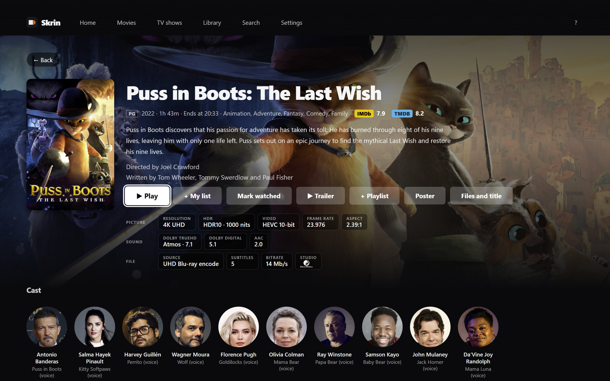
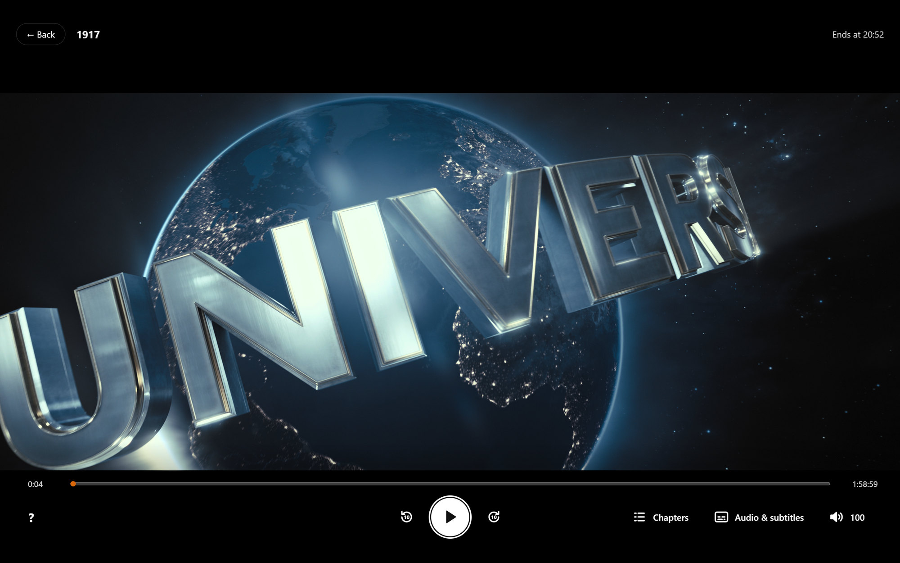

# What Skrin does

The long version of the [README](../README.md): why Skrin exists, what it sets up by itself, who it is for, and every feature in detail.

## Why Skrin

Most people who keep their own video files end up choosing between three kinds
of program, each good at one thing:

- **VLC and MPC-HC play anything and just work**, which is why so many people
  never leave them. But what you get is a file browser with a player in it: no
  posters, no "continue watching", no next episode, no Skip intro — none of the
  niceties of a modern streaming app.
- **Kodi** needs no server, plays almost anything and can be tuned to do exactly
  what you want, which is why enthusiasts love it. The flip side: it can be
  clunky to find your way around, its many settings are a lot for a newcomer,
  and the best-looking skins are heavy, so they can make it sluggish, most of
  all on a modest PC or a TV box.
- **Plex and Jellyfin** look the part and close the gap, but only once a server
  is running somewhere and somebody keeps it maintained.

Skrin is the one in between: the library and polish of a streaming app, the
"press play and it works" of VLC, and no server. It is a single program that
looks good out of the box, with nothing to host, skin or maintain. Its
interface is part of the program rather than a skin on top of one, and it eases
off its own effects on weaker hardware, so it stays quick on a TV box as well
as a big PC.

## It sets itself up

Getting a film to look and sound right at home depends on things most people
have never heard of: whether the screen switches to the film's 24 frames a
second or shows it with judder, whether HDR is on, which sound formats the
receiver can take untouched, which subtitles should show. Enthusiasts spend
hours on this in MPC-HC or Kodi. Everyone else never does, and gets a picture
or sound that is a little wrong without ever knowing.

Skrin asks your equipment what it can do, and sets things up from the answer:

- **The screen matches the film**: its refresh rate for smooth 24p, and HDR
  switched on for an HDR film.
- **Atmos, DTS:X and TrueHD go to a receiver untouched**, when the receiver
  takes them.
- **Subtitles in your language** when the sound is in another, and none when it
  is not.
- **A film is never matched to the wrong title.** When Skrin is not sure, it
  puts the file aside for you to check instead of guessing.

You answer a few plain questions once, on the first run, each with what it
gives and what it costs, and each skippable. If you know what all this means,
the setup is the part you get to skip, and the details are one key away: press
`i` while watching to see the display's real refresh rate, the frame cadence,
which scaler ran and why, and the colour pipeline end to end. It reports
rather than flatters.

There is no quality preset to fiddle with, on purpose: the right choice depends
on the film and the screen, and Skrin already knows both. Nothing is invented
either. No machine-learning upscaling that makes up detail the master never
had, and no frame interpolation that makes up frames.

## Is it for you?

**Yes, if** you keep your own movies and shows as files — on a PC, a laptop
plugged into the TV, a Linux box or an Android TV box — and want them to look
and sound right without it becoming a project:

- **You never wondered what a refresh rate or a sound format has to do with a
  film**, and you should not have to. Skrin sets it up, so the picture and the
  sound are what the film's makers meant, on the equipment you have.
- **You know exactly what they are**, have spent evenings in a config file for
  them, and would rather have them just work. Skrin does what you would have
  configured, shows its working when you press `i`, and gives the evenings back.

**Probably not, if you want:**

- **Your library on every screen in the house, or on the road.** With no server,
  a film plays on the device Skrin runs on. Several devices can read the same
  NAS, but each keeps its own library and its own place in a film.
- **Streaming-service apps or an add-on store.** Skrin plays the files you own.
  Keeping that kind of thing working is a job of its own, and Skrin is built to
  run for years without one.
- **A tuning bench.** If you enjoy comparing upscalers and writing shader
  chains, Skrin takes those decisions away on purpose: no quality presets, no
  machine-learning upscaling, no frame interpolation. What is in the film is
  what is shown.
- **Apple TV, iPhone or iPad.** Not planned. A Mac version is possible one day,
  with no promise attached.
- **Something to pay for.** Skrin is free and open source, and will stay that
  way: no premium tier, no subscription, no "unlock 4K" button. If paying is how
  you know software is good, we are sorry; there is nobody to hand the money to.

## What it does

Detail pages carry the cast, the description and — for a series — every season
and episode, opening on the season you are in, with progress on the ones you
have started. Under the buttons, badges say what the file really holds — for a
series, what the season on screen holds, and which episodes differ — and
beside the year are its age rating and its IMDb, Rotten Tomatoes and TMDB
scores. Posters everywhere show what you have watched.

A remote works the way it does on any streaming app: **OK** pauses, **←/→**
seek (hold to go faster), and **↑/↓** bring up the controls — the seek bar,
audio and subtitles, volume. Back steps back to wherever you came from.

- **Finds your movies and shows** by walking folders you nominate. It never reads
  file contents to identify them, so scanning a NAS stays cheap.
- **Fetches posters, backdrops, descriptions, cast and episode stills**, and
  caches them locally so browsing works with no connection.
- **Refuses to guess.** A match it is not confident about goes to a review queue
  with the reason, rather than silently attaching the wrong movie to your file —
  and Home tells you when something is waiting there.
- **Plays through mpv** — the same engine as the standalone player — with
  hardware decoding, HDR tone mapping, PGS subtitles and 4K remuxes. On
  Android it plays through Android's own media player (Media3) instead, which
  takes Dolby Vision and sound for a receiver straight from the system.
- **Reads from a NAS or a USB drive** as easily as from a local disk: SMB
  shares are browsed and signed in to from inside Skrin, and a share that is
  switched off is left alone rather than treated as an empty library.
- **Says what each file really holds.** A title's page shows the resolution,
  the Dolby Vision profile — with FEL or MEL — and HDR format, the exact sound
  format (TrueHD Atmos, DTS:X, DD+ Atmos), frame rate, bit depth and the aspect
  ratio measured from the picture itself, so a 2.39:1 film in a 16:9 file says
  2.39:1. Where it came from (UHD Blu-ray remux, WEB-DL…) is read from the
  release name ("UHD" only if the picture is 4K), and so is Auro-3D (shown
  only if the file has a PCM or lossless sound track to hold it); nothing
  else is.
- **Keeps home videos and clips apart.** A Videos folder holds what is neither
  a film nor a show, never matched, each with a picture taken from the file,
  under the Library tab. In the TV layout, Library → Folders browses your
  drives and shares inside Skrin and plays any video in them; at a desk the
  same tile is **Add a folder**, which opens the system's folder window.
- **Playlists.** Put films, episodes and videos in an order you choose and play
  them through; import and export `.m3u` lists on Windows and Linux. Add a whole season, or
  one episode with the + on its row.
- **Remembers where you were**, per file, and offers the next episode.
- **Tells SIMKL and Trakt what you watched**, if you connect them: whatever you
  finish in Skrin is added to your account. Connecting is a code on screen and a
  tap on your phone. With Trakt connected, Skrin also continues where you
  stopped on another device (a switch in Settings turns it off); SIMKL only
  receives.
- **Keeps a safety copy** of your watch history, resume points and hand-made
  matches once a week, and puts one back from Settings if the library is ever
  damaged.
- **Skips intros, recaps and credits**, from two community databases, from
  chapter markers, or by fingerprinting a season's audio and finding what the
  episodes share. Where a film has a scene after its credits, Skip takes you
  straight to it.
- **Works from a sofa.** Browsing, searching (with an on-screen keyboard),
  playing, subtitles and resume all work with a D-pad, and the TV layout fills
  the screen with bigger text.
- **Speaks your language.** Subtitles in your language when the audio is in
  another, and none when it is not — set once, remembered per show when you
  change it. Forced subtitles, for the lines in yet another language, show
  even with subtitles off.
- **Finds subtitles online** when a file has none in your language: one press
  in the player takes the best from OpenSubtitles — one made for your exact
  file when there is one — and the rest are a list away. It can also fetch
  forced subtitles by itself.
- **Gets the most out of your equipment.** Atmos and DTS:X untouched, 24p
  without judder, HDR switched on for an HDR film — for every TV and receiver
  that can, only the ones you choose, or none, so a laptop can behave one way
  at a home cinema and another at a desk. The first run asks; Home says when
  something connected can do more than you have chosen.

Press `i` while watching — or choose Playback details at the end of Audio &
subtitles, or a remote's Info key — for what is actually happening: the display's real
refresh rate, the frame cadence, which scaler ran and why, and the colour
pipeline end to end. It reports rather than flatters — the cadence line above is
telling the truth about 24p on a 60 Hz panel.

It reads [NFO sidecar files](DESIGN.md) if you have them, from MediaElch,
tinyMediaManager or Kodi, and treats them as authoritative.
